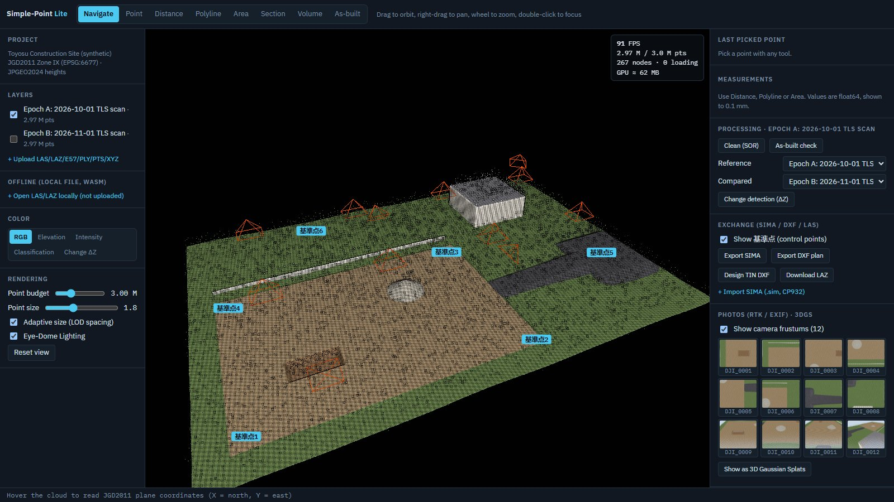
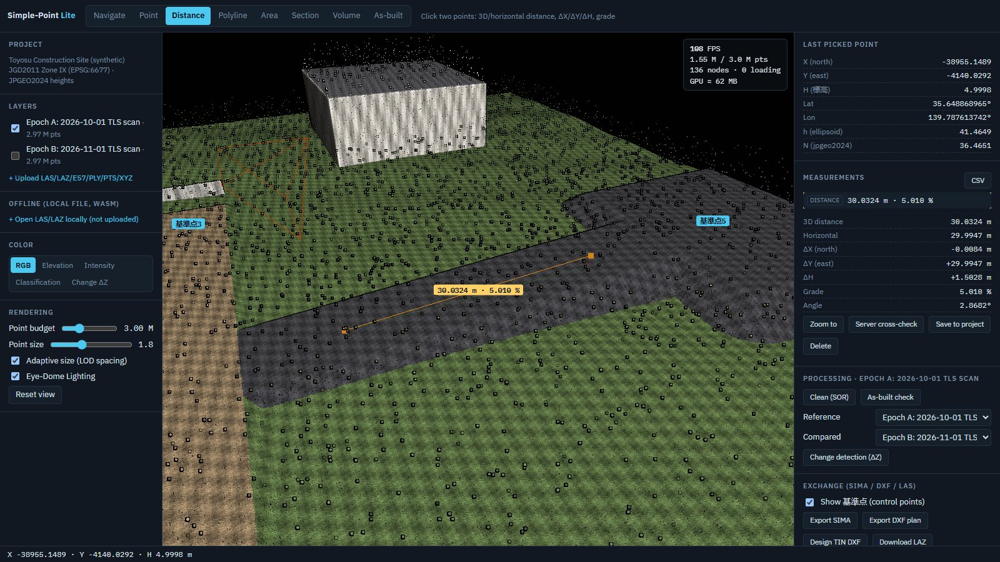
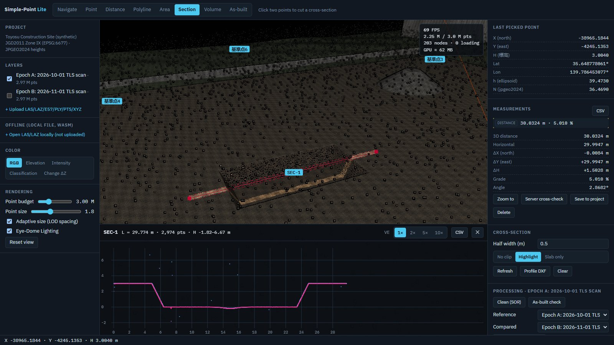
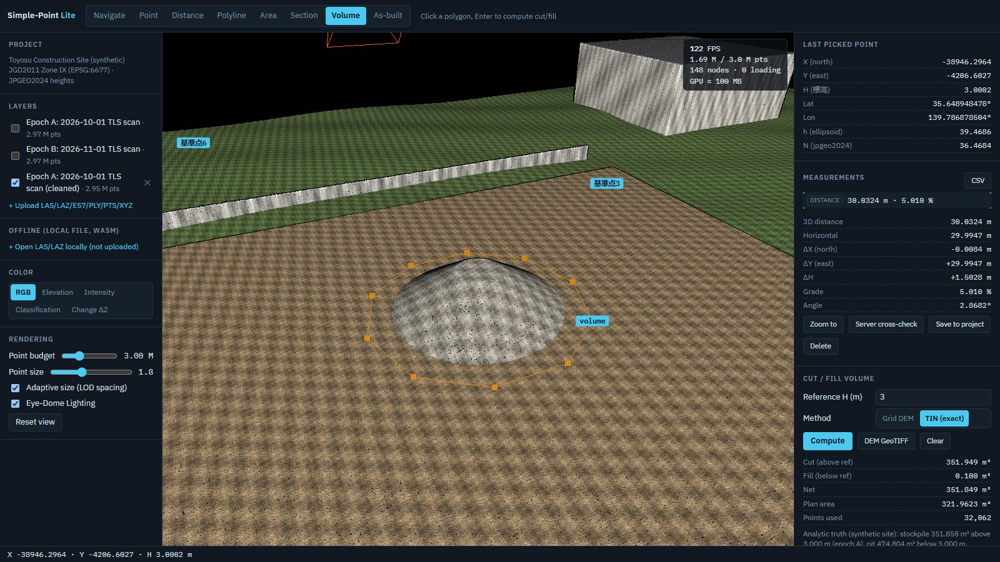
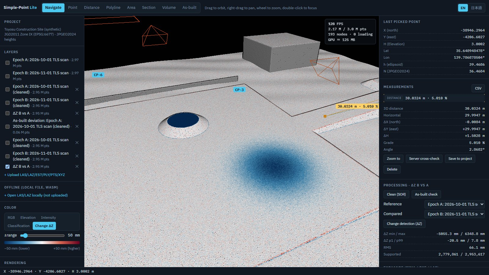
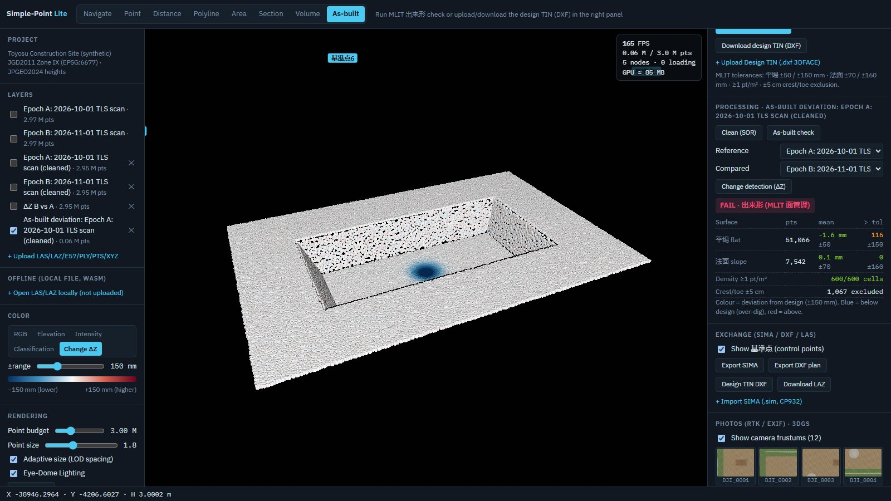
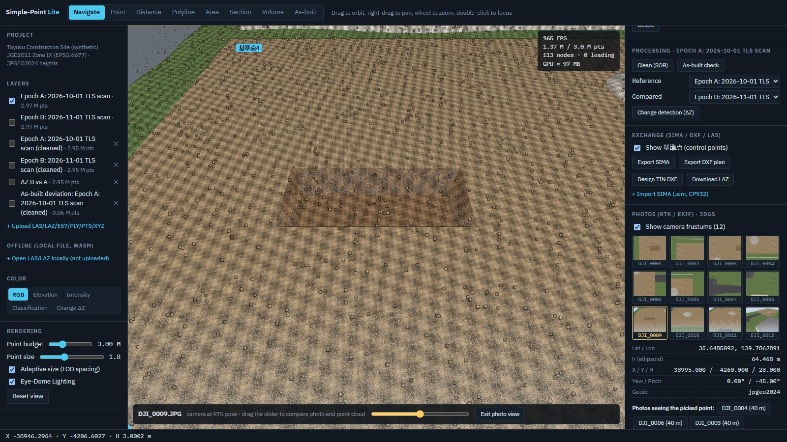
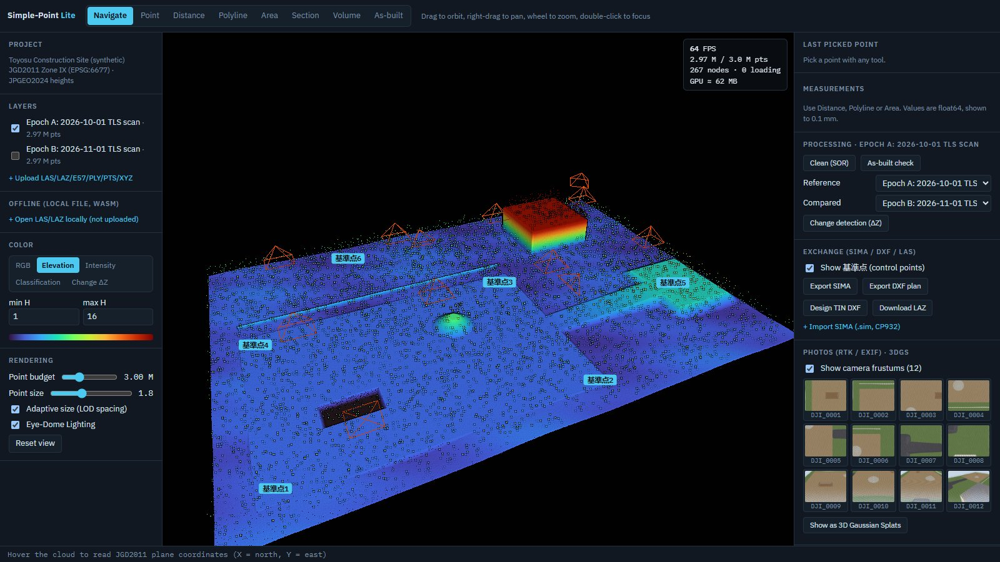
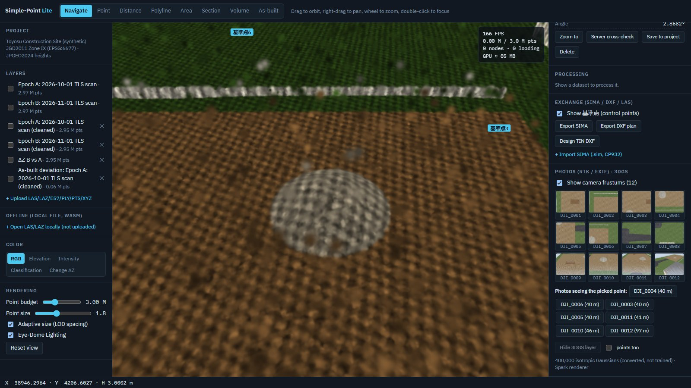

# Simple-Point Lite

A browser-based 3D point cloud platform for surveying and construction, built as a working demonstration for the APEX Co., Ltd. Full-Stack Engineer role (React / AWS / Point Cloud & 3D). It's a small, open-source take on what APEX's Simple-Point (SimpleCloud) does, with every survey number verified against independent ground truth.

**Stack:** React 19 + TypeScript + Three.js (custom octree renderer, Spark for 3DGS) · Python 3.12+ (tested on 3.13/3.14) + FastAPI + NumPy/SciPy, laspy, pyproj/PROJ, ezdxf, pye57, rasterio · SQLAlchemy/Alembic · AWS CDK. 100 % open-source libraries.

| | |
|---|---|
| Verification | [`VERIFICATION_REPORT.md`](VERIFICATION_REPORT.md): measured errors in mm for every check |
| How it was built | [`AI_AGENT_WORK_LOG.md`](AI_AGENT_WORK_LOG.md): spec → criteria → implementation → what verification caught |
| Specs | [`docs/specs/`](docs/specs/): acceptance criteria from GSI/MLIT primary sources |
| Architecture & AWS cost | [`docs/ARCHITECTURE.md`](docs/ARCHITECTURE.md) |



## Screenshots

| | |
|---|---|
|  **Measuring the ramp:** 30.0324 m at 5.010 % (truth 5 %). ΔX(north)/ΔY(east)/ΔH to 0.1 mm, lat/lon and JPGEO2024 geoid height for the picked point. |  **Cross-section through the pit:** true-scale CAD profile with the 1:0.5 walls, the floor and the over-dig dip. Slab highlighted in 3D. |
|  **Cut/fill:** exact TIN on the cleaned scan gives 351.949 m³ against the analytic 351.858 m³ (+0.026 %). |  **Change detection, epoch A → B:** the −45 mm settlement bowl and the stockpile removal. |
|  **As-built (出来形) check against the design TIN:** FAIL, with 116 points beyond ±150 mm at the over-dig. |  **RTK photo view:** camera placed from EXIF GPS + XMP orientation, photo aligned with the cloud (≤ 0.25 px). |
|  **Elevation colouring** (Turbo), LOD HUD with point budget. |  **3D Gaussian Splatting layer:** 400 k Gaussians converted from the cloud, rendered with Spark. |

Screenshots are produced by `scripts/screenshots.py`, which drives the running app in headless Chrome through real mouse input.

## Features

- **Viewer:** streaming octree LOD with a point budget (0.25–10 M), frustum culling, LRU cache, adaptive point size, Eye-Dome Lighting. FPS / points / nodes / GPU-memory HUD. Colour by RGB, elevation, intensity, classification or ΔZ.
- **Measurement (0.1 mm):** point, 3D/horizontal distance, ΔX(north)/ΔY(east)/ΔH, grade % and °, polyline, plan area. GPU ID picking returns the exact stored float64 point. Lat/lon, ellipsoidal height and JPGEO2024 geoid height for any picked point. Browser vs Python cross-check. Saved to the project database.
- **Cross-sections:** slab clipping in 3D and a true-scale 2D CAD profile (vertical exaggeration, ground-snapped measuring, station cursor linked to 3D). DXF/CSV export.
- **Processing:** Statistical Outlier Removal; cut/fill volume (exact TIN prisms or median-grid DEM); GeoTIFF DEM; M3C2-lite change detection between epochs; **as-built inspection (出来形管理) against a design TIN with MLIT tolerances** (平場 ±50/±150 mm, 法面 ±70/±160 mm, ±5 cm crest/toe exclusion, ≥1 pt/m² density).
- **CRS:** WGS84/JGD2011 ⇄ Japan Plane Rectangular CS IX (EPSG:6677) with **JPGEO2024** (official since 2025-04-01) or GSIGEO2011. Matches GSI's calculators to < 0.05 mm.
- **Interop:** LAS/LAZ/E57/PLY/PTS/XYZ in and out; SIMA (CP932, X = north) import/export; DXF plan/profile/design TIN (3DFACE) import/export.
- **Photos:** RTK drone photos with EXIF GPS + DJI-style XMP orientation. Camera frustums, "which photos see this point", and a photo view that aligns the photo with the cloud (≤ 0.25 px).
- **3D Gaussian Splatting:** point cloud → 3DGS PLY (INRIA layout), rendered with Spark in the same scene.
- **Offline mode:** open a local LAS/LAZ entirely in the browser (laz-perf WASM + TypeScript octree in a Web Worker, no upload).
- **Platform:** multi-tenant projects with owner/editor/viewer roles, background jobs, derived-dataset lineage, Alembic migrations. AWS CDK stack (S3 → Lambda → SQS → Fargate Spot, CloudFront, RDS, least-privilege IAM, budget alarm) and Docker.
- **Bilingual (EN / 日本語):** live toolbar switcher (`localStorage`), localized control points (`CP-1`–`CP-6` / `基準点1`–`6`), 3D overlays, client-translated structured API/worker error codes, UTF-8 BOM CSV, CJK DXF text styles, and `?lang=en|ja` CP932-safe SIMA exports.

The synthetic site is a deterministic ~3 M-point TLS scan of a construction site near Toyosu, Tokyo, in JGD2011 Zone IX. It has analytically known features: a 1:0.5 pit (474 m³), a frustum stockpile (351.858 m³), a 5.000 % ramp, a building, a retaining wall, 6 control points (基準点), a −45 mm settlement bowl in epoch B, a −200 mm over-dig defect, 3 mm noise and 0.5 % outliers. Every test compares against these exact values.

## Run locally (Windows / macOS / Linux)

```bash
cd backend
python -m venv .venv
.venv/Scripts/python -m pip install -e ".[dev]"
.venv/Scripts/python ../scripts/fetch_grids.py
.venv/Scripts/python -m uvicorn app.main:create_app --factory --port 8000
```

On macOS/Linux use `.venv/bin/python`. On the first start the server seeds the demo project (two 3 M-point epochs plus 12 photos, about 20 s).

```bash
cd frontend
npm install
npm run dev
```

Open http://localhost:5173. Or run everything with Docker: `docker compose up --build`, then open http://localhost:8080.

## Verify

```bash
powershell -File scripts/verify.ps1
```

This runs pytest (backend), vitest + tsc (frontend) and the CDK assertion tests, then regenerates `VERIFICATION_REPORT.md` with the measured errors.

## Repository

```
backend/    FastAPI app (app/core = algorithms, app/api = routes), tests, Alembic migrations
frontend/   React + Three.js viewer (src/engine = renderer, src/geo = survey maths, src/offline = WASM path, src/i18n = EN/JA localization)
shared/     golden test vectors used by BOTH pytest and vitest
infra/      AWS CDK stack + assertion tests
docker/     Dockerfiles + nginx; docker-compose.yml at the root
docs/       specs, architecture, review checklist
scripts/    verify, golden-vector generators, geoid grid download
```

Licences: GSI geoid grids CC-BY 4.0 (via PROJ-data). All libraries are open source (MIT/BSD/Apache-2.0/LGPL).
